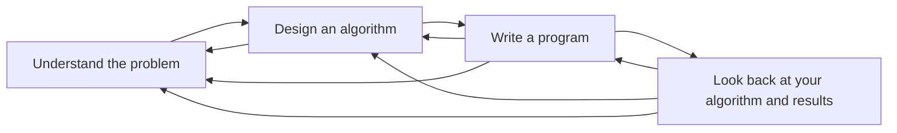

# 02 — Launch into Computing

| | |
| --- | --- |
| Module code | *to confirm* |
| Cohort | October 2026 A |
| Dates | Started 19 October 2026; end date *to confirm* |
| Tutor | Beran Necat |
| Result | in progress |

## Learning outcomes

The module's stated outcomes, numbered as the handbook numbers them, each followed by one line on where on this page the evidence for it is.

1. *To copy from the module handbook.*

## Artefacts and feedback

| Artefact | Due | Submitted | What it is | Feedback | Link |
| --- | --- | --- | --- | --- | --- |
| | | | | | |

Added as each piece of work is set. Feedback is quoted verbatim where I have permission; otherwise summarised. Under each piece of feedback: what I did with it.

## Code

## Reflection

*To write after the result.* Three questions: what I believed before the module, what the evidence from the module did to that belief, and what I will do differently.

## Meeting notes

| Date | With | Purpose | Decisions and actions |
| --- | --- | --- | --- |
| 23 October 2026 | Beran Necat (tutor) and cohort | Unit 1 live seminar — Foundations of Computing and Digital Systems | Discussion answers and slides prepared in advance; see Seminars below. |

## Seminars

### Unit 1 — Foundations of Computing and Digital Systems (23 October 2026)

First live seminar, tutor Beran Necat.

**Knowledge objectives:** what computing is, its key components, and its role in modern technology; the basics of logic gates and Boolean algebra in digital computing; set theory and its application in computing and database design.

**Skills objectives:** analyse real-world applications of computing and digital logic; apply Boolean logic and logic gate operations to solve computational problems; use set operations to represent and manipulate computational data.

**Structure:** (1) Icebreaker — computing in everyday life; prompt: how computers process information, and what role logic plays in their decision-making. (2) Introduction to computing — evolution from mechanical systems to AI-driven automation; classical vs quantum computing; impact on healthcare, finance, and cybersecurity; case study: automated decision-making in financial markets. (3) Logic, gates and Boolean algebra — AND, OR, NOT, XOR, NAND, NOR; truth tables and Boolean expressions; activity: construct truth tables and determine circuit outputs. (4) Set theory in computing — sets, subsets, unions, intersections; relational databases and search algorithms; AI and big data; activity: Venn diagrams for database queries and search indexing.

Prepared discussion answers and a short slide deck in advance of the session.

## Professional skills matrix and action plan

| Skill | Before (1–5) | After (1–5) | Evidence on this page | Action to use or extend it |
| --- | --- | --- | --- | --- |
| | | | | |

Rolled up into the [programme skills record]({{ "/skills/" | relative_url }}) when the module is finished.

## Connection to the thesis

*To record as it emerges.* Which part of [moepa-thesis](https://github.com/PhilipAsiala/moepa-thesis), if any, this module informed, and the commit that carried it there.
